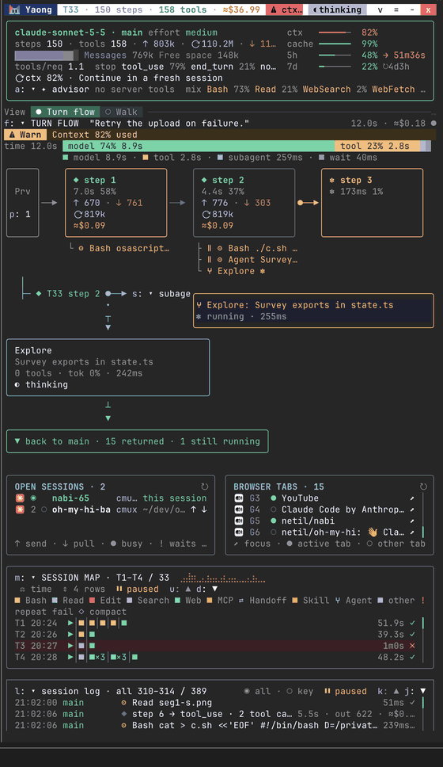
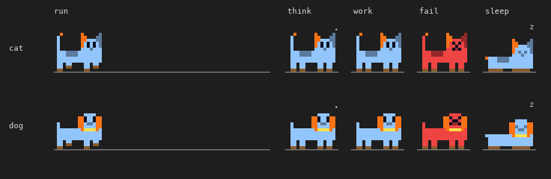

<h1 align="center">
  <picture>
    <source media="(prefers-color-scheme: dark)" srcset="docs/images/logo-dark.png">
    
  </picture>
</h1>

Yaong is a panel beside your [Claude Code](https://claude.com/claude-code) conversation that shows, turn by turn, where the time and money went.

Yaong (야옹) is the Korean word for a cat's meow: a cat that sits next to the conversation and watches every turn.

## Install

```bash
claude plugin marketplace add netil/yaong
claude plugin install yaong@yaong --scope user
```

Run `/reload-plugins`, then open the panel with `/yaong`. It also opens by itself when a session starts. New versions install automatically (turn this off in the settings screen, `=` in the header).

## Features

- **Turn flow**: every model request, tool call, and subagent of the turn in order, with tokens, cost, and a time share bar
- **Gauges and advice**: context, cache hit rate, and the 5h and 7d usage limits with a forecast. Rule-based advice flags repeated failures, cache drops, and files read again. All computed locally, no tokens spent
- **Session map and log**: one row per turn to compare, and a replay of any recent turn. The log switches between key events and everything
- **Walk view**: press `v` and a pixel cat or dog walks through the turn. Its mood shows context, cost, and usage limits at a glance
- **Open sessions**: send this session's handoff to another Claude Code session or a coding agent (Codex, OpenCode, ...), or pull theirs here
- **Browser tabs**: your open tabs, numbered. Say "B3" or "the GitHub PR tab" and the model works in that tab
- **Terminal and desktop app**: the same panel in both

<p align="center">
  
</p>

The walk view's cat and dog: running, thinking, working, failing, and sleeping.

<p align="center">
  
</p>

See the [manual](docs/MANUAL.md) for the layout, shortcuts, advice rules, and [settings](docs/MANUAL.md#settings).

## Requirements

- Claude Code with mod (function hooks) support
- The walk view's pixel art uses octant characters (Unicode 16) in Ghostty, kitty, and WezTerm. Other terminals (Obsidian's terminal, iTerm2, Terminal.app, VS Code) get a coarser version drawn with quadrant blocks, so the layout holds

## Development

```bash
claude plugin validate .
claude plugin test .
```

Without `claude plugin test`, run the event-order regression test with Node.js 24 or later. It uses an in-memory adapter and doesn't replace the engine and UI integration tests.

```bash
node --test tests/lifecycle.test.mjs
```

To try local changes, load the folder directly with `claude --plugin-dir .` and run `/reload-plugins` after edits.

The test kit doesn't paint the panel, so layout breaks at narrow widths are checked separately. `tools/layout-check` renders the terminal panel with Ink (an approximation of the engine's renderer) at widths from 26 to 120 columns and reports rows wider than the panel and Box props the engine refuses. It exits 1 when it finds any.

```bash
cd tools/layout-check && npm install
node check.mjs              # default view; or pass widths: node check.mjs 26 40 60
VIEW=avatar node check.mjs  # walk view (also SETTINGS=1, MODE=band for the minimized view)
FRAMES=1 node check.mjs 30  # print the frames, to spot titles wrapping into columns
```

## Release

1. Run `claude plugin validate .` and `claude plugin test .`
2. Raise `version` in `package.json` and `.claude-plugin/plugin.json` (installed copies update only when it changes)
3. Move the changelog entries under a new `## vX.Y.Z (date)` heading
4. Commit, then `git tag vX.Y.Z`, `git push --follow-tags`, and `gh release create vX.Y.Z --notes-file <notes>`

## License

[MIT](LICENSE)
