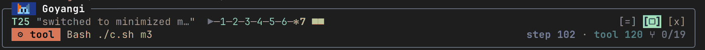
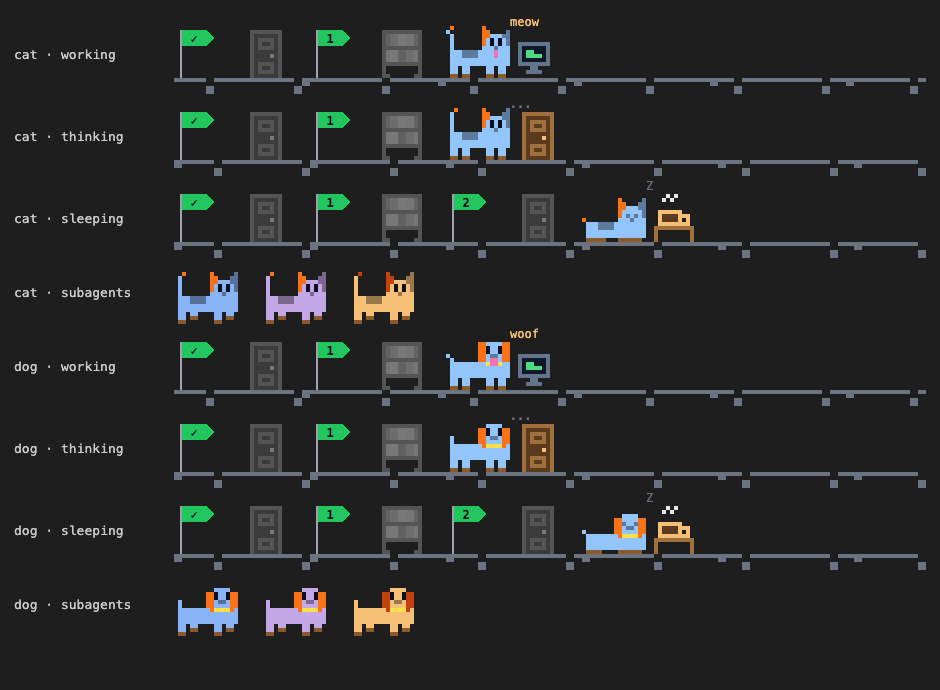

# Goyangi manual

## Install

```bash
claude plugin marketplace add netil/goyangi
claude plugin install goyangi@goyangi --scope user
```

Run `/reload-plugins`, then open the panel with `/goyangi`.

Goyangi checks for a new version when a session starts (at most once an hour) and installs it. A toast tells you to run `/reload-plugins`. Only copies installed from the `goyangi` marketplace are checked. Turn it off with **Auto update** in the settings screen, then update by hand with `claude plugin update goyangi@goyangi`.

## Open, move, close

| Action | How |
|---|---|
| Open | `/goyangi` |
| Settings | `=` in the header (`⚙` on desktop) |
| Switch view | `[Turn flow]` / `[Walk]` above the turn flow, or `v` |
| Move (right / above prompt) | `v` or `>` in the header (`⇵` on desktop) |
| Minimize | `-` in the header, or `c` |
| Expand again | `[□]` in the minimized view |
| Close | `x` in the header, or `x` |

Shortcuts work while the panel has focus. Click the panel once to focus it. Hover a header button to see its name.

## Minimized view

Minimizing leaves two rows above the prompt, so the conversation gets the full terminal width.



- **Row 1**: turn number, start of the prompt, and a track of main's steps. `▶` is the prompt, numbers are model requests, `■` is the answer. Green is done, red is failed, and the running step spins with its tools as colored blocks. Buttons `[=]` `[□]` `[x]` sit at the right end
- **Row 2**: what main is doing now, then advice counts, steps and tools, and running subagents (`⑂ 1/2`)
- With the walk view on, the pet joins the track

## Layout

### Header

Logo, session summary (turns, steps, tool calls, cost), a status chip, and buttons. The header stays at the top while you scroll. On narrow panels the summary goes first, then the logo shrinks, so the buttons always fit.

| Chip | Meaning |
|---|---|
| `○ idle` | Nothing running |
| `◐ thinking` | Waiting on the model |
| `⚙ tool` | Running a tool |
| `● live` | A subagent is running |
| `✗ idle` | The last turn failed |

### Main loop

- **Left**: model and effort (plus the running command), steps, tool calls, tokens (`↑` input, `⟳` cache, `↓` output), the context bar, and a request summary (hover for details and the slowest tools)
- **Right gauges**: `ctx` (orange from 60%, red from 80%), `cache` (hit rate, red under 50%), `5h` and `7d` usage limits (`→ 12m` time left at this rate, `↻ 2h` time to reset)
- Under 64 columns the gauges move below the left rows
- The last row lists server tools (advisor, web search, ...) with call counts and average time. Shortcut `a` folds it

**Continue in a fresh session.** When context passes the alert threshold, `⟳ ctx 85% · Continue in a fresh session` appears. One click writes a handoff note, runs `/clear`, and starts a new session whose first prompt points at the note. The old session stays available with `claude --resume <id>`. At 95% or more Goyangi writes the note itself without a model turn. The **Fresh session** setting picks `Ask`, `Auto`, or `Off`.

### Turn flow

How the turn unfolded (`f`).

- Top row: prompt, turn time, turn cost. Then advice, edited files (✎), and files read
- Time bar: model, tool, subagent, and wait
- Step boxes: one per model request with time, tokens, and cost. Branches below are the tools and subagents it called
- Branch marks: `◐` running, `⏳` possibly stalled, `✓` success, `✗` failure, `∥` parallel, `⚠×2` repeated failure
- Long turns fold into `Prv` and `Nxt` boxes. Move with `p` and `n`

### Walk view

`[Walk]` or `v` swaps the turn flow for a side-scrolling scene. The choice persists.



- **Path**: main and up to 3 subagents each get a path. Spots are the prompt, model requests, and the answer. A step's tools hang below its spot
- **Pet**: a calico cat or a dog (Character in settings). It runs to the next spot during a request, works in place while a tool runs, sleeps when the turn ends, and turns red with an X over its eyes on failure
- **Scoreboard**: `HI 00042 00007` is tool calls for the session and for this turn
- **Replay**: click a past turn in the session map to walk through it again. `T5 replay · latest ▸` returns to the live turn

The pet also shows the session's numbers:

| Number | Pet |
|---|---|
| Context from 60% | Tired eyes. At the alert, everything moves at half pace |
| Turn cost (15%, 50%, 100% of the alert) | A `$`, `s$`, `sS$` mark over its back |
| 5h limit (60%, 90%) | Sky turns to dusk, then night |
| Advice | A `!` (warning) or `?` (tip) bubble |

Props show the kind of work: thought bubble (thinking), terminal (Bash), code editor (Edit, Write), bookshelf (Read), magnifier (Grep, Glob), globe (web), server rack (MCP), door (Agent, prompt), coffee cup (answer, waiting).

Ghostty, kitty, and WezTerm draw the pixels with octant characters. Other terminals use quadrant blocks (▘▀▙), where one-pixel details blur. The desktop app draws the scene as SVG.

### Subagents

One box per running subagent (`s`): type, status, recent tools, tool count, token share, and time. Click a name to filter the turn flow and session log. Finished agents are counted in `back to main · N returned`.

### Open sessions

Other Claude Code sessions on this machine (and coding agents such as Codex, OpenCode, and Aider in cmux), refreshed every 30 seconds or with the refresh icon. Each row shows a number, state (`●` busy, `○` idle), name, and folder. This session comes first, marked `◉`.

- `↑ send` passes this session's handoff to that session (name, folder, current request, edited files, last messages, and the `claude --resume` command)
- `↓ pull` asks that session for its handoff
- `↗ focus` brings its window forward
- A number stays with its session until this one ends or `/clear`, so "send this to session 2" always means the same session. The model has a `sessions` tool (`mcp__goyangi__sessions`) that uses the same numbers
- In the turn flow a handoff is a purple branch: `⇢ api #2` (send), `⇠ docs-1 #1` (pull)
- If a send is refused by auto mode's review, add `SendMessage` to `permissions.allow` in settings.json
- Coding agents take a note as a file and a typed prompt line. Their pull reads the last 200 lines of the agent's terminal

### Browser tabs

Open tabs of every running browser: Chrome, Brave, Edge, Arc, Vivaldi, Chromium, ego lite, Safari, Firefox, Whale, and others that script their tabs. Each row has the browser icon, a tab number (`C2`, `B3`), `●` for the window's active tab, title, and site. `↗ focus` brings the tab forward.

- A tab keeps its number until this session ends or `/clear`
- Say "깃헙 PR 탭 내용 알려줘" or "B3 작업해줘". The model uses `browser_tabs` (`mcp__goyangi__browser_tabs`): `list`, `read` (title and URL), `run` (JavaScript in that tab, with your sign-ins), `focus`
- `run` needs View > Developer > Allow JavaScript from Apple Events in that browser. Firefox tabs can be listed and read but not run
- Tabs are read when the session starts and with the refresh icon, never on a timer. A browser that isn't running is never started

On panels about 80 columns or wider, Open sessions and Browser tabs sit side by side.

### Session map

One row per turn (`m`): turn number and time, prompt, tool sequence, tool and edit counts, time, weight bar, cost, outcome. The braille graph shows the last 32 turns.

- `⚖ time` / `⚖ cost` switches the bar. `⇕` changes the height
- Click a turn number to replay it (last 10 turns)
- `u` and `d` scroll. Drag the `┃` bar to jump

### Session log

One row per event (`l`). `◉ all · ○ key` toggles key events only (prompts, subagents, answers, compaction, server tools, failures, cache drops). `k` and `j` scroll and show `⏸ paused`; scroll to the end to return to `● live`.

### Footer

Three rows: `Sections` (fold buttons), `Panel` (minimize, switch view, close), and `Keys` (shortcut hints). The version is shown next to the settings title.

## Shortcuts

| Key | Action |
|---|---|
| `a` `f` `s` `m` `l` | Fold advisor, turn flow, subagents, session map, session log |
| `p` `n` | Previous and next step |
| `u` `d` | Scroll the session map |
| `k` `j` | Scroll the session log |
| `v` | Switch view |
| `c` | Minimize |
| `x` | Close |

## Advice and alerts

Advice is computed from this turn's records only. It never calls a model.

It appears under the turn flow title: `⚠ Warn` is a problem to check now, `💡 Tip` is waste worth cutting. Click `+1 ▾` to expand, hover for evidence. At 80% context a red `⚠ ctx 82%` chip joins the header. When minimized, only counts remain (`⚠1 💡1`).

| Advice | Condition |
|---|---|
| Context warning | Context 70% or more |
| Repeated failure | The same call failed 2 or more times in a turn |
| Cache hit rate drop | The rate dropped sharply within the 5 minute cache lifetime |
| Usage limit approaching | 50% or more used and reached within 30 minutes at this rate |
| Usage limit 90% or more | 90% or more used |
| Same range read again | The same file range read 3 or more times without edits |

Toasts fire once per situation (the context alert re-arms when usage drops below the threshold):

| Situation | Default threshold |
|---|---|
| Context usage | 80% |
| Turn cost | $2 |
| Tool or subagent stalled | 120s |
| Same call failing again | 2 failures |
| Cache hit rate drop | Same as the advice |
| Usage limit approaching, or 90% or more | Same as the advice |

## Settings

Press `=` in the header (`⚙` on desktop). Changes apply immediately and persist. `Reset to defaults` clears them.

| Item | How to change | Default |
|---|---|---|
| Open on session start | `On` / `Off` | On |
| Auto update | `On` / `Off` | On |
| Panel position | `Right` / `Bottom (above prompt)` | Right |
| Context alert | `−` / `+`, steps of 10% | 80% |
| Turn cost alert | `−` / `+`, steps of $1 | $2 |
| Stall threshold | `−` / `+`, steps of 30s | 120s |
| Fresh session | `Ask (one click)` / `Auto` / `Off` | Ask |
| Refresh icon | `Auto` / `Nerd Font` / `Unicode ↺` / `ASCII R` | Auto |
| Open sessions rows | `−` / `+`, 1 to 10 | 4 |
| Browser tabs rows | `−` / `+`, 1 to 10 | 4 |

0 turns an alert off. An auto-opened panel waits until the terminal is at least 110 columns wide.

Initial values for some items come from plugin options (`/plugin configure goyangi@goyangi`): `autoOpen`, `ctxAlertPercent`, `turnCostAlertUsd`, `stallSeconds`, `sessionRows`, `tabRows`. A value changed in the settings screen takes precedence.

### Refresh icon

`Auto` draws a Nerd Font symbol in Ghostty, kitty, and WezTerm, `↺` in other UTF-8 terminals, and `R` otherwise. Set it by hand if your font disagrees, for example Obsidian's terminal with a Nerd Font installed.

### Panel position

At the bottom, Goyangi closes the right split (Pane) and draws the same screen above the prompt, using at most half the terminal height. It stays visible while another mod's panel is open on the right. Shortcuts work while the area is selected (click it, or `ctrl+x tab`).

## Good to know

- Cost is the increase in the session's running cost between requests. A request that overlapped others leaves its step cost empty and adds only to the turn total
- The panel shows this session's records. Only the session map's today and 7-day totals combine sessions
- Subagent stalls are judged only when events stop between requests and tools
- Records are capped: 80 log rows, 40 session map turns, 10 archived turn flows
